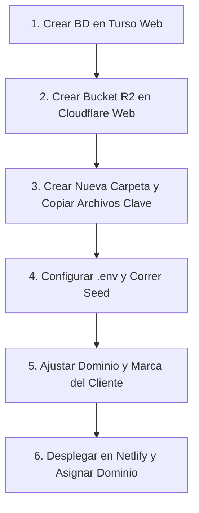

# 🚀 Guía de Despliegue Multi-Tenant (Deploy Independiente por Cliente)

Este sistema está diseñado con una arquitectura **Multi-Tenant Aislada (Deploy + Base de Datos + Storage independiente por cliente)**.

Esta guía está ajustada a tu flujo real de trabajo:
1. **Creación visual en la web** (Dashboard de Turso y Cloudflare, sin consola).
2. **Duplicación limpia del proyecto** (creando una nueva carpeta para el cliente y copiando exactamente los archivos necesarios, sin basura como `node_modules`, dist o temporales).

---

## 📋 Resumen del Flujo de Trabajo



---

## 🗄️ Paso 1: Base de Datos en Turso (Vía Web / Dashboard)

No necesitas usar consola. Todo se hace desde [turso.tech](https://turso.tech):

1. **Crear la Base de Datos**:
   - Entra al dashboard de Turso.
   - Haz clic en **Create Database**.
   - Nombre sugerido: `tienda-[nombrecliente]` (ej: `tienda-calzados-express`).
   - Elige la región más cercana (ej: `iad` o `gru`) y haz clic en **Create**.

2. **Copiar la URL**:
   - En la vista general de la base de datos creada, verás el campo **Database URL**.
   - Será algo como: `libsql://tienda-calzados-express-[tu-org].turso.io`
   - 👉 **Guarda este valor para `TURSO_DATABASE_URL`**.

3. **Generar el Token de Acceso**:
   - Ve a la pestaña **Settings** (o **Access Tokens**) dentro de la base de datos.
   - Haz clic en **Create Token**.
   - asígnale un nombre o déjalo por defecto y copia el token largo.
   - 👉 **Guarda este valor para `TURSO_AUTH_TOKEN`**.

---

## ☁️ Paso 2: Bucket de Imágenes en Cloudflare R2 (Vía Web)

1. **Crear el Bucket**:
   - Entra a [dash.cloudflare.com](https://dash.cloudflare.com).
   - Ve a **R2 Object Storage** > **Create bucket**.
   - Nombre: `tienda-[nombrecliente]-media`.
   - Ubicación: **Automatic**. Clic en **Create bucket**.

2. **Habilitar Acceso Público (Para mostrar las imágenes en la web)**:
   - Dentro del bucket, ve a **Settings** > pestaña **Public Access**.
   - En **R2.dev subdomain**, haz clic en **Allow Access** y escribe `allow`.
   - Copia la URL pública generada (ej: `https://pub-abc1234567.r2.dev`).
   - 👉 **Guarda este valor para `S3_PUBLIC_URL`** *(OJO: sin barra `/` al final)*.

3. **Obtener las Claves API (Access Key y Secret)**:
   - Vuelve a la pantalla principal de **R2** (menú izquierdo).
   - En el panel derecho haz clic en **Manage R2 API Tokens**.
   - Clic en **Create API Token**.
   - Permiso: **Object Read & Write**.
   - Clic en **Create API Token**.
   - Copia y guarda de inmediato:
     - **Access Key ID** 👉 para `R2_ACCESS_KEY_ID`.
     - **Secret Access Key** 👉 para `R2_SECRET_ACCESS_KEY`.
     - **Endpoint S3 API** 👉 para `S3_ENDPOINT` (ej: `https://<ACCOUNT_ID>.r2.cloudflarestorage.com` — *sin el nombre del bucket al final*).

---

## 📂 Paso 3: Qué Archivos Copiar a la Nueva Carpeta del Cliente

Crea una nueva carpeta vacía para el cliente (por ejemplo: `C:\...\tiendas\tienda-calzados-express`).

### ✅ Archivos y Carpetas que SÍ DEBES COPIAR:

| Carpeta / Archivo | ¿Por qué es necesario? |
| :--- | :--- |
| `src/` | **Todo el código fuente**: layouts, páginas, componentes, estilos, endpoints y librerías. |
| `public/` | Favicons, robots.txt y recursos estáticos base. |
| `scripts/` | Contiene `seed-admin.mjs` para poblar la BD inicial. |
| `package.json` | Lista todas las dependencias y scripts de Astro. |
| `pnpm-lock.yaml` | Asegura que se instalen exactamente las mismas versiones de paquetes. |
| `astro.config.mjs` | Configuración de Astro, adaptadores (Netlify) y alias. |
| `tsconfig.json` | Configuración de TypeScript. |
| `.gitignore` | Evita subir node_modules y .env al repositorio del cliente. |
| `.env.example` | Plantilla para armar el nuevo `.env`. |

---

### ❌ Carpetas y Archivos que NUNCA DEBES COPIAR:

| NO copiar | Motivo |
| :--- | :--- |
| `node_modules/` | Ocupa cientos de MB y se regenera limpio con `pnpm install`. |
| `.astro/` | Cache temporal compilada por Astro. |
| `dist/` | Build viejo de producción anterior. |
| `.netlify/` | Vinculaciones locales y configuraciones viejas de Netlify. |
| `.git/` | El historial Git del demo; cada cliente debe tener su propio Git limpio. |
| `.env` | Contiene las credenciales y tokens del cliente anterior. |
| `local.db` | Si existe archivo sqlite local de pruebas, no debe ir a producción. |

---

## ⚙️ Paso 4: Configurar `.env` e Instalar Dependencias

Abre la terminal en la nueva carpeta del cliente:

1. **Instalar dependencias**:
   ```bash
   pnpm install
   ```

2. **Crear el archivo `.env`**:
   Crea el archivo `.env` en la raíz de la nueva carpeta y pega tus datos obtenidos:

   ```env
   # ===========================================
   # TURSO (Base de datos del cliente)
   # ===========================================
   TURSO_DATABASE_URL=libsql://tienda-cliente-org.turso.io
   TURSO_AUTH_TOKEN=eyJhbGciOi...tu_token_turso...

   # ===========================================
   # SEGURIDAD (Generar uno aleatorio)
   # ===========================================
   JWT_SECRET=supersecreto_aleatorio_largo_del_cliente

   # Credenciales iniciales para que el cliente acceda a /admin
   ADMIN_EMAIL=admin@tiendacliente.com
   ADMIN_PASSWORD=Contraseña123*
   ADMIN_NAME=Administrador

   # ===========================================
   # CLOUDFLARE R2 (Imágenes del cliente)
   # ===========================================
   R2_ACCESS_KEY_ID=tu_access_key_r2
   R2_SECRET_ACCESS_KEY=tu_secret_key_r2
   R2_REGION=auto
   S3_BUCKET=tienda-cliente-media
   S3_ENDPOINT=https://ACCOUNT_ID.r2.cloudflarestorage.com
   S3_PUBLIC_URL=https://pub-xxxxxx.r2.dev
   ```

3. **Correr la Semilla Inicial**:
   Este comando lee `src/lib/db/schema.sql`, crea todas las tablas, los índices y da de alta al usuario administrador:
   ```bash
   pnpm run db:seed-admin
   ```
   *Debe responder `Esquema OK`, `Admin creado` y `Listo.`*

---

## ✏️ Paso 5: Archivos que Debes Modificar por Cliente

Solo son **3 archivos** de configuración y los favicons:

1. **`astro.config.mjs`** (Línea 10):
   Cambia la URL por el dominio del cliente (o el subdominio de Netlify):
   ```javascript
   site: 'https://tiendacliente.com',
   ```

2. **`public/robots.txt`** (Línea 10):
   Ajusta la URL del sitemap:
   ```text
   Sitemap: https://tiendacliente.com/sitemap.xml
   ```

3. **`src/pages/sitemap.xml.ts`** (Línea 7):
   Ajusta la constante con el dominio del cliente:
   ```typescript
   const SITE = 'https://tiendacliente.com';
   ```

4. **`public/` (Logos y Favicons)**:
   Reemplaza los archivos de `favicon.ico`, `favicon.png`, `favicon.svg` y `favicon.webp` por los de la marca del nuevo cliente.

---

## 🚀 Paso 6: Despliegue en Netlify

1. **Subir a un nuevo repositorio Git**:
   ```bash
   git init
   git add .
   git commit -m "feat: setup inicial cliente"
   git branch -M main
   # Vincula a tu GitHub (ej: github.com/tu-usuario/tienda-cliente)
   git remote add origin https://github.com/tu-usuario/tienda-cliente.git
   git push -u origin main
   ```

2. **Crear el sitio en Netlify**:
   - En Netlify, dale a **Add new site** > **Import an existing project** y selecciona el nuevo repo.
   - Build command: `pnpm run build`
   - Publish directory: `dist`
   - En **Site configuration** > **Environment variables**, añade las variables de tu `.env`:
     - `TURSO_DATABASE_URL`
     - `TURSO_AUTH_TOKEN`
     - `JWT_SECRET`
     - `R2_ACCESS_KEY_ID`
     - `R2_SECRET_ACCESS_KEY`
     - `R2_REGION`
     - `S3_BUCKET`
     - `S3_ENDPOINT`
     - `S3_PUBLIC_URL`
   - Clic en **Deploy**.

3. **Dominio Propio (Opcional)**:
   - En Netlify > **Domain management**, añade el dominio del cliente (ej: `tiendacliente.com`) y apunta los DNS.

---

## 🏁 Paso 7: Configuración Final en el Panel

Entra a:
```text
https://tiendacliente.com/admin
```
Inicia sesión con el correo y contraseña configurados en el `.env` y define desde el panel visual:
- Logo de la empresa.
- WhatsApp de recepción de pedidos.
- Colores corporativos de la marca.
- Creación de categorías, productos e inventario.
